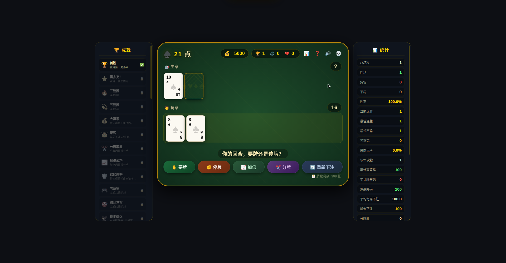

<div align="center">

# 🃏 blackjack-21

[](https://github.com/Civinar-Riley/blackjack-21/actions/workflows/deploy.yml)
[](https://civinar-riley.github.io/blackjack-21/)
[](https://vite.dev/)
[](https://developer.mozilla.org/zh-CN/docs/Web/JavaScript)
[](package.json)

**经典 21 点（黑杰克）网页游戏 —— 要牌 / 停牌 / 加倍 / 分牌 / 保险，一个都不少**

### [▶️ 点我直接玩](https://civinar-riley.github.io/blackjack-21/)



### [🎮 游戏厅（4 款游戏合集）](https://civinar-riley.github.io/blackjack-21/arcade/)

> 本仓库还有个 `arcade` 分支做的**游戏厅**：21 点 / 扫雷 / 赛马场 / 连连看，一个大厅随便选。每个游戏独立沙箱运行，存档自动保存。

</div>

## ✨ 玩法功能

- 🂡 **完整规则**：要牌、停牌、加倍、分牌（最多 4 手）、庄家明牌 A 时可买保险
- 💰 **筹码系统**：5000 开局，输光可一键重开，破产也有体面
- 🏆 **40 个成就**：首胜、黑杰克、三连杀、大富翁…… 解锁有全屏弹幕式通知
- 📊 **详细统计**：胜率、连胜、净赢筹码、黑杰克率，右侧面板实时看
- 🔊 **原生音效**：Web Audio 合成的发牌 / 筹码 / 胜负音，无需任何音频文件
- ⌨️ **快捷键**：`H` 要牌 / `S` 停牌 / `D` 加倍 / `P` 分牌 / `Space` 发牌 / `R` 重置 / `M` 音效
- 📱 **响应式**：手机、平板、桌面自适应，三栏变单栏
- 💾 **本地存档**：筹码、统计、成就存在浏览器 localStorage，每个人独立互不干扰

## 🕹️ 规则速览

| 牌面 | 点数 |
|------|------|
| 2–10 | 按面值 |
| J / Q / K | 10 点 |
| A | 11 或 1 点（自动取最优） |

- 庄家 17 点（含软 17）停牌
- 黑杰克（A + 10 点牌）赔付 **3:2**
- 6 副牌，剩余不足 52 张自动重洗

## 🛠️ 技术栈

- **Vite 6** + 原生 HTML / CSS / JS —— 零运行时依赖，打包后仅 ~70KB
- **GitHub Actions** → **GitHub Pages**：推送到 `main` 自动构建部署

## 🚀 本地运行

```bash
npm install
npm run dev      # 开发服务器
npm run build    # 构建产物到 dist/
npm run preview  # 预览构建结果
```

## 📁 项目结构

```
blackjack-21/
├── index.html                  # 页面骨架
├── vite.config.js              # 构建配置
├── docs/screenshot.png         # 展示截图
├── src/
│   ├── main.js                 # 入口：挂载样式 + 启动游戏
│   ├── styles/main.css          # 全部样式
│   └── game/
│       ├── config.js           # 配置（牌副数、下注上下限、赔付等）
│       ├── sound.js            # 音效引擎（原生 Web Audio）
│       ├── cards.js            # Deck（多副牌靴）/ Hand（手牌与算分）
│       ├── achievements.js     # 40 个成就 + 统计管理器
│       └── game.js             # 游戏主类：状态、下注、判定、渲染
└── .github/workflows/deploy.yml  # 自动部署到 GitHub Pages
```
